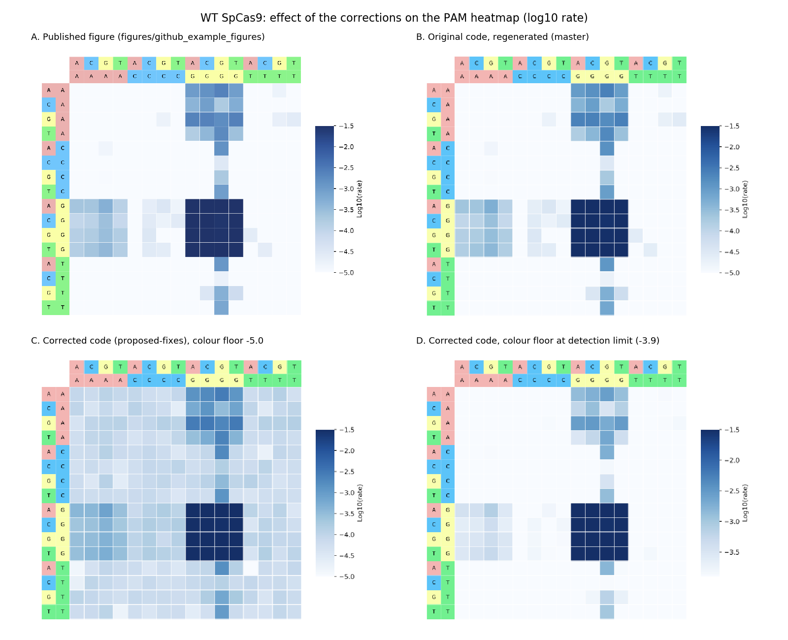
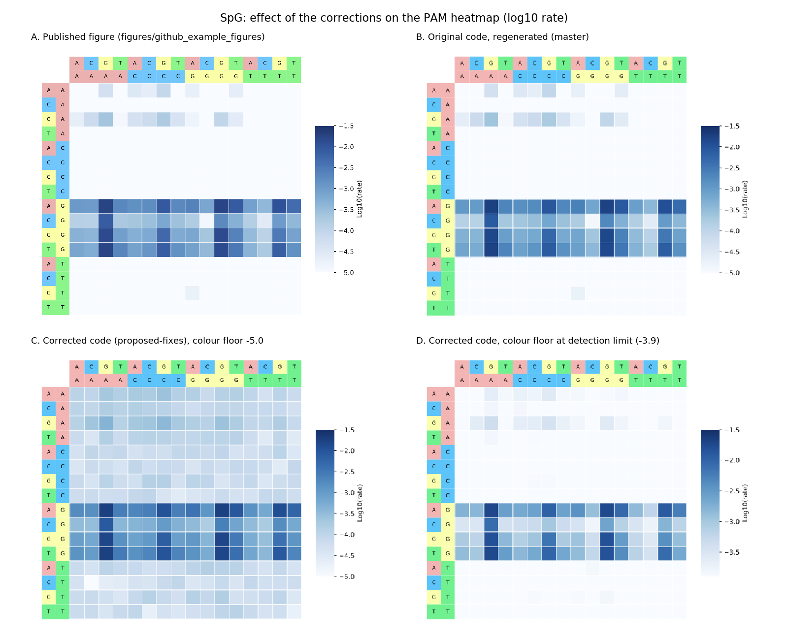
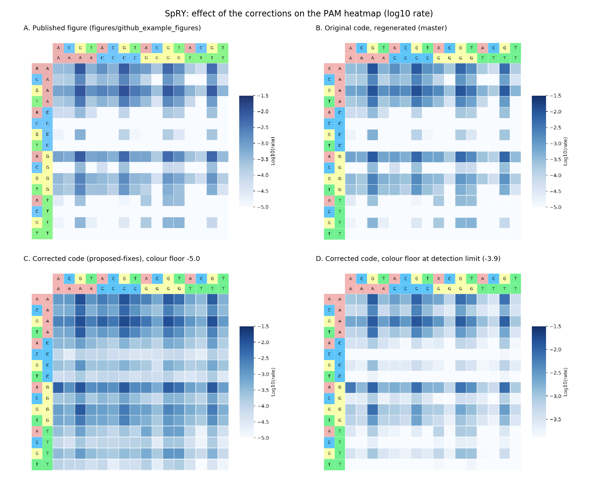

# Effect of the enrichment-normalization correction on the PAM heatmaps

This note compares the HT-PAMDA heatmaps produced by the original code (`master`) with those from the corrected code (`proposed-fixes`), and explains the difference.

Of the corrections on `proposed-fixes`, only one changes the output for the bundled example data: the top-N enrichment correction in `rawcount2normcount`, which is now applied (Issue 2 in `REVIEW_FINDINGS.md`). The other corrections affect only configurations the example does not use.

## Summary

- The original code's clean white background does not mean those PAMs were measured as uncleaved. Their fitted rates were ≤ 0, so the code replaced them with a single floor value (log10 k = −6.74). That value is below the heatmap's colour minimum of −5, so they are drawn white.
- With the correction applied, those PAMs receive rates of about log10 k ≈ −4. This background is mostly the method's **detection limit** at this sequencing depth. A simulation with no cleavage outside NGG produces almost the same background.
- Part of the background is real signal. The two spacers agree on it, and the PAMs above the detection limit include every NAG and NGA PAM: the known secondary PAMs of SpCas9.
- The fast rates and the main conclusions for each enzyme are essentially unchanged.
- Setting the colour floor at the empirical detection limit (panel D below) gives a figure about as clear as the published one, while keeping the reproducible weak PAMs.

## Why the normalization is needed

Sequencing measures relative abundance. As cleavable PAMs are depleted, every uncleaved PAM makes up a larger share of the remaining reads, so it appears to increase over time. In the WT SpCas9 sample, the median relative abundance of non-NGG PAMs goes 1.00 → 1.04 → 1.06 → 1.11 across the four timepoints.

Without a correction, an exponential-decay fit gives those PAMs a negative rate. The code then replaces every non-positive rate with the smallest positive rate in the run. The top-N correction (`TOP_N_NORMALIZE`) is meant to remove this compositional shift. It takes the 5 most-enriched PAMs in each sample as the "uncleaved" reference and rescales each timepoint to them.

Leaving the correction out (as the original code does in effect) underestimates every rate. The bias grows with the enzyme's overall activity: SpRY depletes many PAMs, so its uncorrected rates are biased more than those of WT SpCas9. Comparisons between enzymes are affected accordingly.

## How much of the new background is signal?

To measure what the corrected pipeline produces from noise alone, I simulated sequencing counts for the WT SpCas9 sample:
- the real control-library PAM composition and the real read depth at each timepoint;
- NGG PAMs cleaved at their estimated rates, and **every other PAM with k = 0**.

I ran the simulated counts through both versions of the code, 5 replicates each. These results are for the 480 non-NGG rate constants (240 PAMs × 2 spacers):

| | Median log10 k | Fraction at floor value | Spacer 1 vs spacer 2 (Spearman) |
|---|---|---|---|
| Observed data, corrected code | −4.06 | 0% | **0.48** |
| Null simulation, corrected code | −4.19 | 4% | 0.04 |
| Null simulation, original code | −6.80 | 67% | 0.01 |

How to read the table:

1. **Most of the corrected background is the detection limit.** Data with no cleavage outside NGG give almost the same background (−4.19 vs −4.06). The reference is the 5 *most enriched* PAMs, and these are partly enriched by sampling noise. Every other PAM therefore looks slightly depleted against them, which sets a floor near log10 k ≈ −4 at this depth.
2. **The original code's white background is the same floor drawn differently.** In the null simulation, the original code puts 67% of the uncleaved PAMs at the floor value. In the real WT data it is 76%. So the white cells in the published figure mean "no detectable cleavage", not "rate measured as zero".
3. **Some of the background is real.** For noise, the spacers do not agree (ρ ≈ 0). In the real data they do (ρ = 0.48).

The 95th percentile of the corrected-code null background is **log10 k = −3.89**. In the real WT data, 120 of the 480 non-NGG rates are above it, against about 24 expected by chance. They cover 80 distinct PAMs:
- **all 16 NAG PAMs**;
- **all 16 NGA PAMs**;
- 11 of 16 NGC PAMs;
- 8 NNGG PAMs (an NGG shifted by one position);
- 29 others.

NAG and NGA are well-known weak PAMs for SpCas9. Their consistent appearance suggests that the corrected code detects real weak cleavage, which the original code places at the floor value.

## Comparison figures

Each figure has four panels:
- **A.** The published example figure (`figures/github_example_figures`).
- **B.** The original code, regenerated. It matches A, which confirms the published figures were made with this code.
- **C.** The corrected code, with the colour scale used in `code/inputs.py` (−5.0 to −1.5).
- **D.** The corrected code, with the colour floor at the detection limit (−3.9 to −1.5). Cells at or below the detection limit are drawn white.

Panel D uses a narrower range than A–C, so the same colour corresponds to a different value. Compare panel D with the others by pattern, not by shade.

### WT SpCas9



The NGG block is unchanged across all panels. Panel D keeps the NAG row (`xA` rows, `Gx` columns) and the NGA cells, which panels A and B show only partly.

### SpG



### SpRY



SpRY's preference for NRN over NYN PAMs is visible in every panel. With the correction, the weaker PAMs (for example the `AC`, `GC` and `xT` rows) show graded rates instead of the floor value.

## Summary statistics (heatmap values, log10 k, averaged over spacers)

| Sample | Median (original → corrected) | Cells ≤ −5 (original → corrected) | Mean of top 16 (original → corrected) |
|---|---|---|---|
| WT SpCas9 | −6.74 → −4.06 | 181/256 → 0/256 | −1.46 → −1.44 |
| SpG | −6.74 → −4.02 | 174/256 → 1/256 | −2.05 → −1.99 |
| SpRY | −4.32 → −3.46 | 115/256 → 1/256 | −2.22 → −2.03 |

## Caveats

- **The detection limit is specific to this dataset.** It depends on sequencing depth and was estimated from the WT SpCas9 sample only. For SpG and SpRY it is an approximation.
- **The top-N reference assumes the most-enriched PAMs are uncleaved.** That holds for WT SpCas9 and SpG. For a near-PAMless enzyme such as SpRY, even the most-enriched PAMs may be cleaved slowly, so its corrected rates may still be somewhat underestimated.
- **Choosing the 5 most extreme PAMs is noisy and biased upward.** This is the main source of the background floor. Two alternatives would reduce it: a reference set chosen in advance (PAMs known to be uncleaved), or a robust central estimate over many PAMs. Reporting rates below an empirical detection limit as "not detected" would also help.

## Reproducing this analysis

Requirements: macOS, the `htpamdaenv` conda environment (`environment.yml`), and local branches `master` and `proposed-fixes`. Then run:

```bash
conda activate htpamdaenv
bash analysis/normalization_comparison/run_comparison.sh [work_dir]
```

The script runs the example pipeline on both branches in temporary git worktrees, runs the null simulation (`simulate_null_background.py`, fixed random seed), re-renders the corrected heatmaps with the colour floor at the detection limit, and writes these files to `figures/normalization_comparison/`:
- the comparison figures;
- both rate tables (`rates_original.csv`, `rates_corrected.csv`);
- the simulation summary (`null_simulation_summary.txt`).
